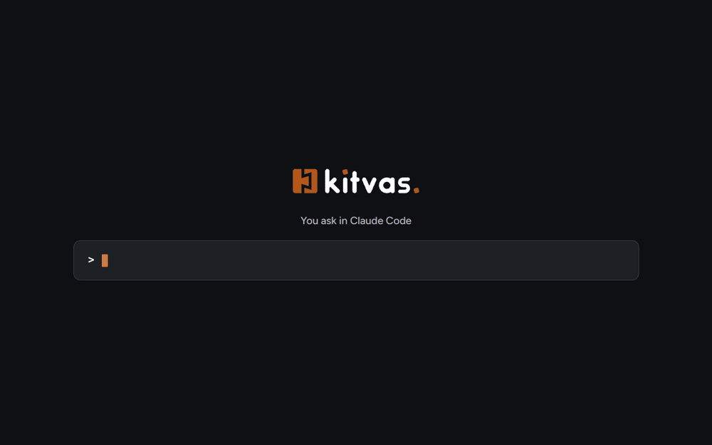
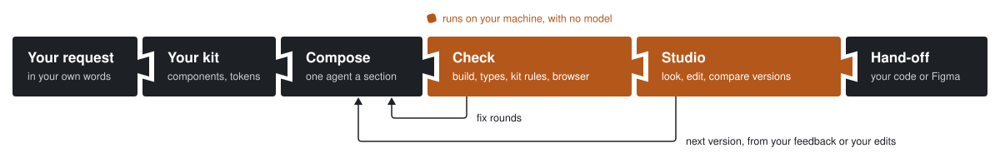
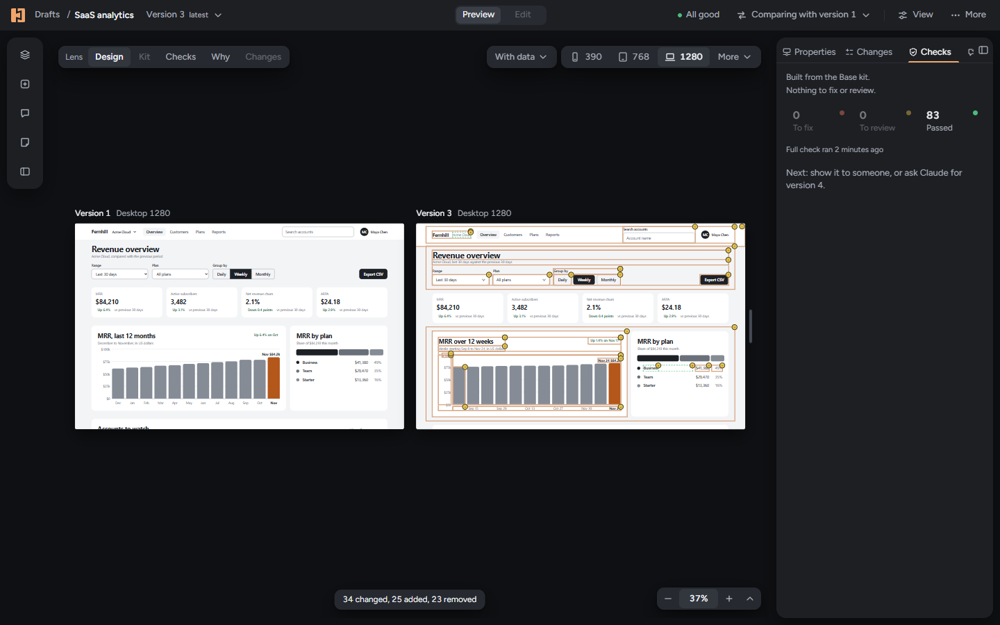
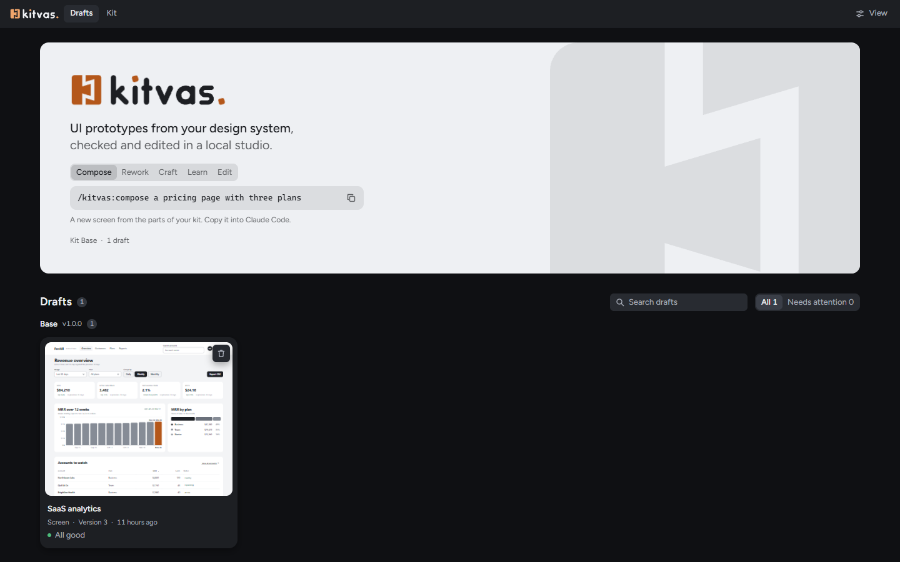
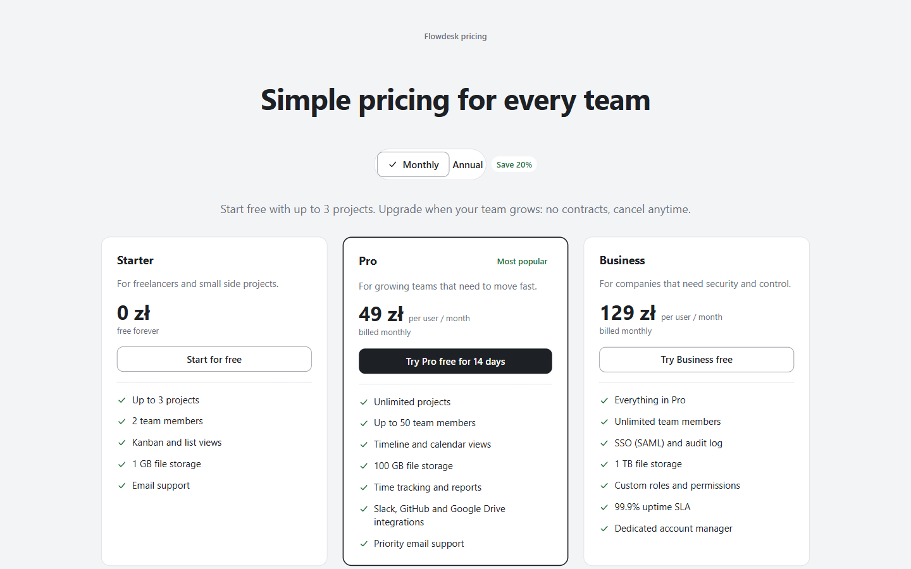
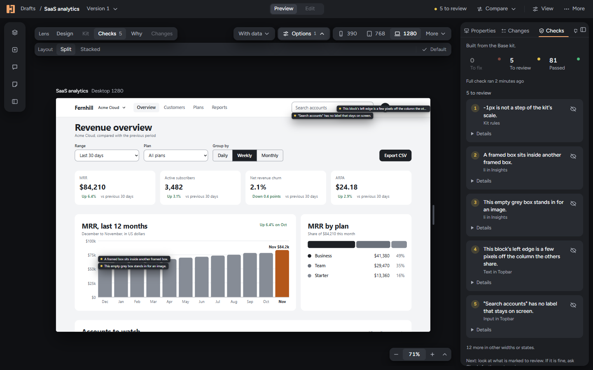

<p align="center">
  <picture>
    <source media="(prefers-color-scheme: dark)" srcset="docs/brand/kitvas-logo-white.svg">
    
  </picture>
</p>

<p align="center"><strong>Build with your design system. Validate automatically. Edit visually.</strong></p>

<p align="center">
  
  <a href="LICENSE.md"></a>
  
  <a href="https://github.com/sponsors/pglejzer"></a>
</p>

kitvas is a Claude Code plugin that builds UI prototypes from your project's own design system, checks them in a real browser and shows them in a local studio with a visual editor. It is for developers and design-system maintainers who want a screen made of their own components and tokens. You end up with a checked React draft that you can edit, version and hand off to your code. Without a learned kit it builds from the built-in kit, Base.



The GIF leaves out the wait for the build; the draft it shows is version 3.

## Install

```bash
claude plugin marketplace add pglejzer/kitvas
claude plugin install kitvas@kitvas
```

Inside Claude Code the same works as `/plugin marketplace add pglejzer/kitvas` and `/plugin install kitvas@kitvas`.

On the first session after an install or an update, a `SessionStart` hook runs `npm ci --ignore-scripts` for the plugin's own packages in the plugin's data folder. No install script of a dependency runs.

## Quick start

In your project folder, in Claude Code:

1. Type `/kitvas`. It reports whether kitvas is ready and what is missing, and offers to create the `.kitvas/` workspace.
2. Choose a kit. If your project has a design system, type `/kitvas:learn`; otherwise go on with Base.
3. Type `/kitvas:compose` with a description, for example `/kitvas:compose a pricing page with three plans and a FAQ`. Claude asks at most three questions, builds the sections, checks them and fixes what it can.
4. Open the link Claude gives you. It is a one-time link, valid for 60 seconds, to `http://kitvas.localhost:<port>/`. Your browser then stays signed in for 30 days.
5. Give feedback in chat, leave a note in the studio, or switch to Edit and change the draft yourself. Feedback in chat makes a new version; an editing session makes one too.

## What it does

### Build with your design system

- `/kitvas:learn` reads an npm package, a components folder, a Figma file, a website or screenshots and writes a kit: components, tokens and icons. It then verifies the kit against the real packages and a browser.
- `/kitvas:compose` writes a brief and a layout, then one agent writes each section in the kit's components and `--kit-*` tokens. Drafts import only from the kit.
- `/kitvas:rework` takes a page you have, as a URL, a screenshot or a Figma link, builds a better version in your kit and checks it against a list of things that must stay.
- `/kitvas:craft` draws a missing component, icon or logo as three sketches. The one you pick is added to your project's additions to the kit.

### Validate automatically

- Every draft is built, type-checked and held to the kit's rules, which flag raw colours and sizes. Then a real browser opens it at several widths and in every state and looks for accessibility, layout and runtime errors. [docs/checks.md](docs/checks.md) lists the widths and what `--deep` adds.
- In the browser, every control is hovered with a real pointer and given keyboard focus, and the contrast of its text is measured in both. Each button, toggle group, select and search field is used once, and a control that changes nothing is reported.

### Edit visually

- A change in the studio lands in the draft's own TSX and SCSS, or Tailwind classes, touching only the lines it changes. Kit tokens come first, every step can be undone, and a change that cannot be written is refused with the reason.
- One version can hold options, such as the number of columns, a kind of card or a theme. They share one build, and the check visits each value. Values a person chooses on the page, such as a date range, can be shared between sections.
- Each round is a version. Two versions open side by side, and the timeline shows any earlier one read-only.
- The editor needs no model. To ask Claude from it, with a sentence about what you selected or with Improve, keep a `/kitvas:edit <draft>` session listening.

### Hand off

- `/kitvas:handoff code` puts a finished draft into your project in its own technology, only where you say.
- `/kitvas:handoff figma` sends editable layers to your Figma file. It needs your own Figma MCP.

## How it works

<p align="center">
  <picture>
    <source media="(prefers-color-scheme: dark)" srcset="docs/readme/workflow-dark.svg">
    
  </picture>
</p>

- You describe a screen. Claude reads the kit and your project's decisions and writes a brief and a layout.
- Agents write the sections, and kitvas builds the draft and checks it in a browser. Claude reads the screenshots and fixes findings in at most two rounds.
- The studio opens on 127.0.0.1, where you look at the draft, edit it or ask Claude from the editor.
- Feedback in chat starts a new version and runs the same path again. When the draft is right, a hand-off puts it into your code or your Figma file.

More in [How it works](docs/how-it-works.md).

## The studio and the editor




| The start page                                                                   | A generated draft                                                                                                                  | The Checks tab                                                                                               |
| -------------------------------------------------------------------------------- | ---------------------------------------------------------------------------------------------------------------------------------- | ------------------------------------------------------------------------------------------------------------ |
|  |  |  |
| Drafts grouped by kit, with live thumbnails.                                     | The prototype as a page, built from the kit.                                                                                       | Findings with a place and a hint, marked on the canvas.                                                      |

## Use cases

- A new screen for a product that already has a design system.
- A page you already have that needs a better version, with its content and purpose kept.
- A component, icon or logo that your kit does not have yet.
- A screen for a project with no design system yet, built from the built-in kit, Base.
- A finished draft that has to go into your project, in the project's own technology.

## Skills

| Skill                           | You give                                                                     | You get                                                                                   |
| ------------------------------- | ---------------------------------------------------------------------------- | ----------------------------------------------------------------------------------------- |
| `/kitvas`                       | Nothing                                                                      | Whether kitvas is ready, the kit in use, the workspace                                    |
| `/kitvas:compose`               | A description of a screen, or feedback on a draft                            | A built and checked draft, and a studio link                                              |
| `/kitvas:rework`                | A page you have: a URL, a screenshot or a Figma link                         | A better version in your kit, checked against a list of things that must stay             |
| `/kitvas:craft`                 | A missing component, icon or logo, and an example                            | Three sketches; the one you pick goes into your kit's additions                           |
| `/kitvas:learn`                 | A design system: a package, a folder, a Figma file, a website or screenshots | A kit in `.kitvas/kits/<id>/`                                                             |
| `/kitvas:kit`                   | A question about the kit                                                     | Its components, tokens and icons                                                          |
| `/kitvas:edit <draft>`          | A draft open in the studio editor                                            | Claude answers the editor's requests while the session listens                            |
| `/kitvas:handoff figma <draft>` | A finished draft, your Figma file and your Figma MCP                         | Editable layers in Figma, with the kit's tokens as variables                              |
| `/kitvas:handoff code <draft>`  | A finished draft and where it goes in your project                           | The draft in your project's own technology, checked by your scripts and against the draft |

Rework keeps the content and purpose and may change the layout. For a URL, the report says how many of the original's problems are gone.

## Runs on your machine

The studio and your files are local. The studio is a process on 127.0.0.1 and needs no account; it stops after 240 idle minutes by default. Your drafts, kits and decisions stay under `.kitvas/` in your project. The plugin's own packages, the browser it downloads and its settings are in `~/.kitvas/`. kitvas writes into your application only through `/kitvas:handoff code`, and only where you say. `craft export` writes to a folder you name.

The model is not local. Claude Code sends what a session reads, such as kit files, draft files, screenshots and your notes, to the model, as in any session. The visual editor alone works with no network and no model; asking Claude from it needs a listening `/kitvas:edit` session.

kitvas itself calls the network in these cases: the npm install of its own packages, the Chromium download when you ask for it, and a page you ask it to read. Local and private addresses are refused unless you allow them. Web research by `kitvas:scout` goes through Claude Code's own tools with public terms only. kitvas sends your drafts to nobody; `/kitvas:handoff figma` sends one to your own Figma file through your own Figma MCP, after you say yes.

The rest is in [docs/security.md](docs/security.md).

## Requirements

- Claude Code.
- Node 24.22.3 or later in the 24 line, or 26.13.1 or later. These are Node's [security releases of 11 November 2026](https://nodejs.org/en/blog/vulnerability/november-2026-security-releases), which fix flaws in HTTP/2, TLS and the HTTP parser. On an older 24 or 26, on Node 25 or on Node 22, kitvas stops with an error that names your version.
- Access to the npm registry during the first session.
- Chrome, Edge or Chromium for the browser checks. `kitvas browser` says which one is used; `kitvas browser install` downloads Chromium when none is found. Without a browser the browser checks are skipped with a note.
- No MCP server is needed. kitvas can use ones you have: a Figma MCP to learn a kit from a Figma file or send a draft to one, an MCP that can read a page behind a login, and Context7.

There is no global `kitvas` command. In these docs `kitvas <command>` means `node <plugin folder>/bin/kitvas.ts <command>`; [Commands](docs/commands.md) says where the plugin folder is.

## Documentation

- [How it works](docs/how-it-works.md): the path of one screen, where files live, and what each agent writes.
- [Your design system](docs/kits.md): how to learn a kit from a package, a folder, Figma, a website or screenshots.
- [Checks](docs/checks.md): what `kitvas check` covers and how findings are waived.
- [The studio editor](docs/editor.md): the studio, every key and rule of the editor, and what works offline.
- [Commands](docs/commands.md): every command, and how to run one by hand.
- [Security](docs/security.md): what leaves your machine, the threat model and the controls. Report a vulnerability through [SECURITY.md](SECURITY.md).
- [When something does not work](docs/troubleshooting.md): `kitvas doctor`, how to open an issue, and the limits.

## Status

1.0.0. Prototypes are React, with SCSS or with Tailwind v4 when the kit uses it, whatever your application is written in; Tailwind v3 is not supported. A hand-off puts a finished prototype into your project in the project's own technology.

## Develop

```bash
npm ci --ignore-scripts
npm run check
```

The rules are in `AGENTS.md`, the decisions in `docs/adr/README.md`, the changes in `CHANGELOG.md` and the skill evals in `evals/README.md`. [CONTRIBUTING.md](CONTRIBUTING.md) says how to report a problem and what a pull request has to pass; everyone who takes part follows the [code of conduct](CODE_OF_CONDUCT.md).

## Support

kitvas is free. If it saves you time or money, you can support its work on [GitHub Sponsors](https://github.com/sponsors/pglejzer).

## License

kitvas is source-available, not open source in the OSI sense. [LICENSING.md](LICENSING.md) says which terms cover which part:

- kitvas is under the [PolyForm Shield License 1.0.0](LICENSE.md). You may use, modify, and distribute it, including for commercial purposes, provided that you do not use it to offer competing products or services.
- The built-in Base kit (`kits/base/`) is under the [MIT License](kits/base/LICENSE): use it, change it, copy it and ship it for any purpose, also in a product that competes with kitvas, and keep its notice with it.
- The interface code you generate with kitvas is not covered: your drafts, the code a hand-off writes into your project and the layers it sends to Figma. A part of kitvas inside it keeps its own license, for example the runtime inside a built prototype.
- The kitvas name and logo are not free to use. You may not change the logo, and you may not use the name or the logo outside kitvas: not for your own product, service, site, kit or fork, and not to suggest that the author of kitvas made or endorses your work. You may say in plain words that your work was made with kitvas.
