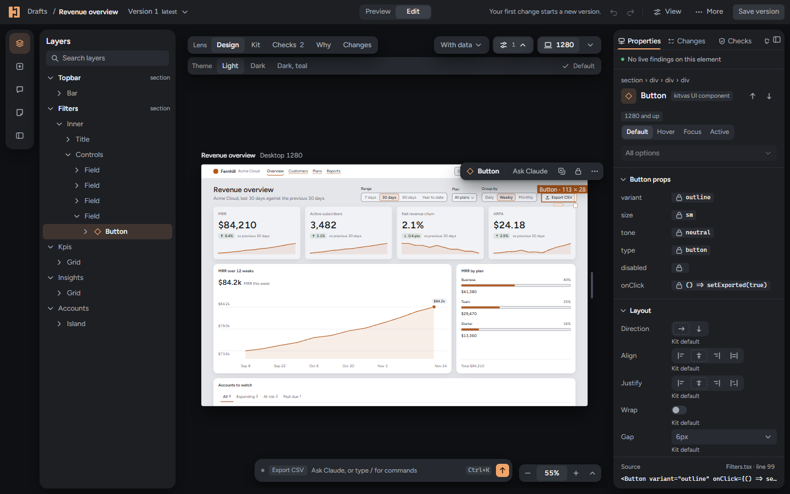

<p align="center">
  <picture>
    <source media="(prefers-color-scheme: dark)" srcset="docs/brand/kitvas-logo-white.svg">
    
  </picture>
</p>

kitvas is a Claude Code plugin that builds UI prototypes from your project's own design system, checks them, and shows them in a local studio where you can edit them.

It is for a developer who has to ship a screen with no designer at hand. You go from an idea to a checked prototype on your own machine.


## Why

- **Generated UI ignores your design system.** kitvas builds only from a kit: the catalog of components, tokens and icons it learned from your project. Without one it uses a built-in kit, Base.
- **Nobody checks the result.** kitvas builds the draft, type-checks it, applies the kit's rules, and opens the page in a real browser at 390 and 1280 px in every state.
- **Changing one detail means prompting again.** The studio's editor writes your change into the draft's own TSX or SCSS, touching only the lines it changes.
- **Generated code lands in your application.** Drafts stay in `.kitvas/` until you export them.

## Runs on your machine

The studio is a local process on 127.0.0.1 and needs no account. Everything stays under `.kitvas/` in your project until you export it, and kitvas never writes into your application.

kitvas itself calls the network in three cases: the npm install of its own packages, the Chromium download when you ask for it, and a page you ask it to read. kitvas sends your drafts to nobody. Claude Code itself sends what it reads to the model, as in any session.

The rest is in [docs/security.md](docs/security.md).

| The studio's start page                           | The editor                                                                                  | A generated prototype                                      |
| ------------------------------------------------- | ------------------------------------------------------------------------------------------- | ---------------------------------------------------------- |
|  |  |  |

## Requirements

- Claude Code.
- Node 24.22.3 or later in the 24 line, or 26.13.1 or later.
- Access to the npm registry during the first session.
- Chrome, Edge or Chromium for the browser checks. `kitvas browser` says which one is used; `kitvas browser install` downloads Chromium when none is found.

There is no global `kitvas` command. In these docs `kitvas <command>` means `node <plugin folder>/bin/kitvas.ts <command>`; [Commands](docs/commands.md) says where the plugin folder is.

## Install

```bash
claude plugin marketplace add pglejzer/kitvas
claude plugin install kitvas@kitvas
```

Inside Claude Code the same works as `/plugin marketplace add pglejzer/kitvas` and `/plugin install kitvas@kitvas`.

On the first session after an install or an update, a `SessionStart` hook runs `npm ci --ignore-scripts` for the plugin's own packages in the plugin's data folder. No install script of a dependency runs.

## Quick start

In your project folder, in Claude Code:

1. Type `/kitvas`. It reports whether kitvas is ready and what is missing, and offers to create the `.kitvas/` workspace.
2. Choose a kit. If your project has a design system, type `/kitvas:learn`; otherwise go on with Base.
3. Type `/kitvas:compose` with a description, for example `/kitvas:compose a pricing page with three plans and a FAQ`. Claude asks at most three questions, builds the sections, checks them and fixes what it can.
4. Open the link Claude gives you. It is a one-time link, valid for 60 seconds, to `http://kitvas.localhost:<port>/`. Your browser then stays signed in for 30 days.
5. Give feedback in chat, leave a note in the studio, or switch to Edit and change the draft yourself. Each round makes a new version.

## Skills

| Skill                  | You give                                                                     | You get                                                                       |
| ---------------------- | ---------------------------------------------------------------------------- | ----------------------------------------------------------------------------- |
| `/kitvas`              | Nothing                                                                      | Whether kitvas is ready, the kit in use, the workspace                        |
| `/kitvas:compose`      | A description of a screen, or feedback on a draft                            | A built and checked draft, and a studio link                                  |
| `/kitvas:rework`       | A page you have: a URL, a screenshot or a Figma link                         | A better version in your kit, checked against a list of things that must stay |
| `/kitvas:craft`        | A missing component, icon or logo, and an example                            | Three sketches; the one you pick goes into your kit's additions               |
| `/kitvas:learn`        | A design system: a package, a folder, a Figma file, a website or screenshots | A kit in `.kitvas/kits/<id>/`                                                 |
| `/kitvas:kit`          | A question about the kit                                                     | Its components, tokens and icons                                              |
| `/kitvas:edit <draft>` | An open studio editor                                                        | Claude answers its requests while you edit                                    |

Rework keeps the content and purpose and may change the layout. The report says how many of the original's problems are gone.

## Read more

- [How it works](docs/how-it-works.md): the path of one screen, where files live, and what each agent writes.
- [Your design system](docs/kits.md): how to learn a kit from a package, a folder, Figma, a website or screenshots.
- [Checks](docs/checks.md): what `kitvas check` covers and how findings are waived.
- [The studio editor](docs/editor.md): the studio, every key and rule of the editor, and what works offline.
- [Commands](docs/commands.md): every command, and how to run one by hand.
- [Security](docs/security.md): what leaves your machine, the threat model and the controls. Report a vulnerability through [SECURITY.md](SECURITY.md).
- [When something does not work](docs/troubleshooting.md): `kitvas doctor`, how to open an issue, and the limits.

## Status

0.1.0, early. Prototypes are React, with SCSS or with Tailwind v4 when the kit uses it, whatever your application is written in.

## Develop

```bash
npm ci --ignore-scripts
npm run check
```

`AGENTS.md` has the rules. `docs/adr/README.md` indexes the decisions. `CHANGELOG.md` lists the changes. `evals/README.md` explains the skill evals.

## License

Licensed under the [PolyForm Shield License 1.0.0](LICENSE.md). You may use, modify, and distribute kitvas, including for commercial purposes, provided that you do not use it to offer competing products or services.
