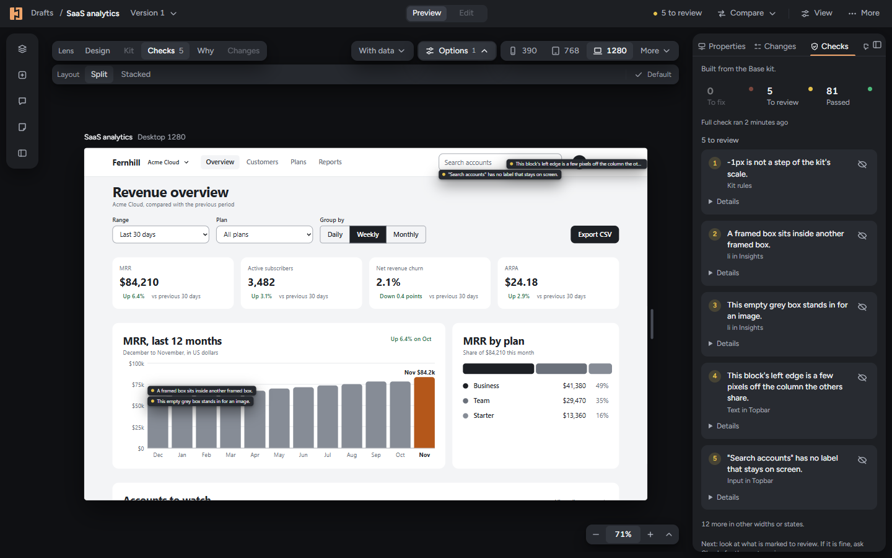

# Checks

What kitvas checks in a draft. For the rest of kitvas, see the [README](../README.md).

`kitvas check <draft>` builds the latest version of a draft and checks it. It writes the result to `build/json/checks.json` in that version, and the screenshots to `build/shots/<state>-<width>.png`. `kitvas guidelines` lists the rules, each with the guidance it is based on.

## What a check runs

- **Build and types.** The build's own errors (esbuild, Sass) and the type check of the draft are findings. Only a type error under `src/` is `fix`.
- **Kit rules.** These read the sources, not the page: imports only from the kit, plain controls where the kit has a component, colours and sizes written by hand instead of tokens, and, for a Tailwind kit, arbitrary or unknown classes. In the page, kit components are held to the kit's catalog: unknown props, bad values, missing props.
- **The browser visit.** The page is opened in a real browser at 390 and 1280 px, in every state of the draft, and a screenshot is written for each state and width. It reads accessibility (axe), blank states, console errors and failed requests, and measures the layout for the `ui` and `ux` rules.
- **The measured visit at 768 px.** Every check also measures the page at 768 px. It takes no screenshot and runs only the rules that look at width.
- **The reflow pass at 320 by 568 px.** It runs in the 390 px visit and reads whether the page still fits a narrow screen.
- **`--deep`.** Adds measured visits at 1024, 1440, 1920 and 2560 px and the slower passes. At the extra widths only the width rules run, such as `ui/upscaled-image`, `ui/stretched-field`, `ui/wrapped-action` and `ui/narrow-column`. Compose runs `--deep` before it hands over a final version.

## Controls

- **Under the pointer and with focus.** At both widths every control is put under the real pointer and given keyboard focus, and its text is read in each state. `a11y/state-contrast` (`fix`) reports a text under 4.5:1 (large text 3:1) when the pointer is over the control or it has focus (ADR 0085).
- **Each control used once.** At 1280 px, last in the visit, each button, group of toggles, select and search field is used once. `ux/dead-control` (`review`) reports one that changes nothing a person can see. Links and form submit buttons are never used. This pass does not run in an option's other values.

## Shared values and options

- **Shared values** (ADR 0086): `ux/shared-unused` (`fix`) reads the sections and reports a value that no control sets or that no section reads.
- **Options** (ADR 0082): the default combination is checked as always, then each value that is not an option's default is visited, one at a time, at 390 and 1280 px in the baseline state. A finding seen only with a value names it. `options/no-effect` (`review`) reports a value whose pages look the same as the default's, and `options/unknown` (`fix`) a `data-opt-` selector in the SCSS that names an option or value the file does not declare.

## Rule families

| Prefix     | What it looks for                                                                                          |
| ---------- | ---------------------------------------------------------------------------------------------------------- |
| `ds/`      | Use of the kit: imports, plain controls, hand-written colours and sizes, props, Tailwind classes          |
| `a11y/`    | Accessibility: axe results and the contrast of a control's text under the pointer and with focus           |
| `ui/`      | Look: type sizes and line length, spacing and alignment, hierarchy, cards, images, overflow, width          |
| `ux/`      | Flow: forms, buttons and links, navigation, empty, loading and error states, controls that do nothing     |
| `runtime/` | The page at run time: a blank state, page errors, console errors and warnings, failed requests            |
| `options/` | Options of a version: a value with no effect, a selector that names an unknown option                      |
| `edit/`    | The editor: a locked element whose source changed or was lost                                              |

Two sets of rules run only for some drafts. A craft board is measured against the kit's icons: `ui/icon-*` and `ui/logo-*`. A rework draft adds `ux/protected` (an item the person asked to keep is missing) and `ux/before-problems` (a problem of the original is not gone).

## Severity

A finding is `fix` when it is wrong: a sourced threshold or plainly broken output. It is `review` when a person decides, and a finding caused by a kit component's own markup is `review`. Every finding has a place, a message and a hint, and a rule's entry in the book says whether its basis is a fetched source or a heuristic.

## Without a browser

The browser checks are skipped with a note, and the build, types and kit rules still run. kitvas downloads nothing unless you run `kitvas browser install`.

## Waivers

A finding you dismiss in the editor, with a reason, is kept in the draft's `waivers.json`. It is listed with its reason in `checks.json` under `waived`, counted in `summary.waived`, and left out of the findings and of the `fix` and `review` counts.
